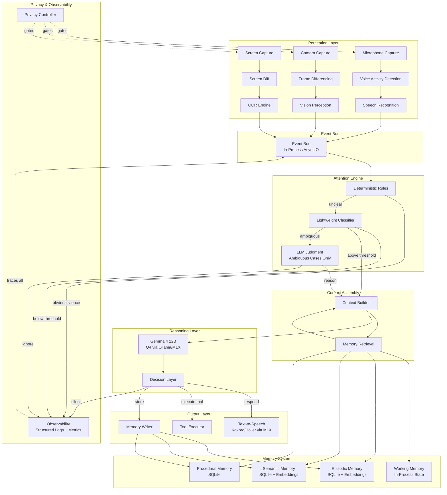
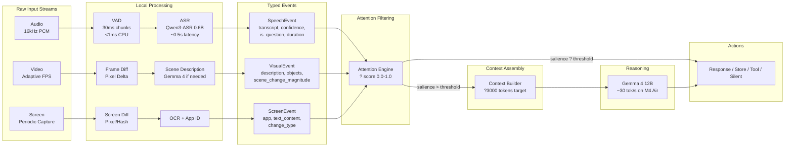
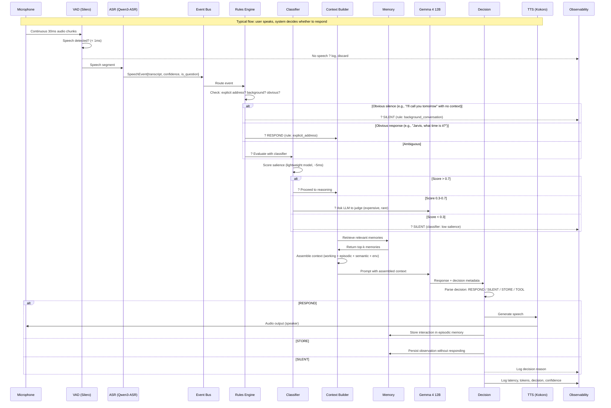

# ?A ? Executive Architecture Overview

JARVIS is a persistent, multimodal personal AI assistant that continuously perceives its environment ? audio, video, screen ? and selectively responds through voice. It has no wake word. The system's intelligence lies not in answering questions but in knowing *when* to answer, *when* to remember, and *when* to stay silent.

## Core Design Principle

**Continuous perception, selective reasoning.** The system maintains constant awareness of its environment through cheap, always-running perception pipelines (VAD, frame differencing, screen change detection). Expensive LLM reasoning is invoked only when the attention engine determines something warrants it. The vast majority of perceived input results in silence ? the correct output.

## Architecture in One Paragraph

Audio flows continuously through a VAD ? ASR pipeline. Video flows through adaptive frame sampling ? change detection. Screen capture flows through diff detection ? OCR. All three produce typed **perception events** that feed into a shared **attention engine** ? a tiered system of deterministic rules, a lightweight classifier, and (for genuinely ambiguous cases) the LLM itself. When the attention engine scores an event above threshold, a **context builder** assembles relevant working memory, retrieved episodic/semantic memories, and current environmental state into a compact prompt for the **reasoning model** (Gemma 4 12B, running locally via MLX/Ollama). The model produces a response and a decision (respond/silent/store/act). If "respond," a local TTS engine speaks. If "store," the memory subsystem persists the observation. The system runs as a single Python process (modular monolith) on the primary development machine (M4 MacBook Air, 16GB).

## Key Architectural Decisions

1. **Python monolith** ? single language, single process, asyncio for concurrency. No microservices.
2. **Local-only inference** ? all models run on-device. Cloud fallback deferred to a future reassessment.
3. **Gemma 4 12B Unified** ? encoder-free multimodal model as the primary reasoning engine. Q4 quantized (~7.6GB), fits in 16GB unified memory.
4. **Tiered attention** ? rules first, classifier second, LLM last. Most input never touches the LLM.
5. **SQLite + in-process event bus** ? minimal infrastructure for a single-user, single-machine system.
6. **Voice-first output** ? TTS is the primary response channel. Text UI deferred.
7. **MCU JARVIS personality** ? dry wit, formal but warm, British butler energy.

## Principles Self-Check (Architectural Principle 16)

Tradeoffs explicitly acknowledged:

- **Local-first vs. capability**: Gemma 4 12B at Q4 on 16GB is capable but not frontier-class. Complex multi-step reasoning, long-form code generation, and nuanced instruction-following will be weaker than a cloud model. Accepted: reassess when quality becomes the bottleneck.
- **Privacy vs. memory richness**: All memory is local, which limits cross-device sync and backup. Accepted: single-machine system for now.
- **Modular monolith vs. isolation**: A single process means a crash in the vision pipeline could take down audio. Mitigation: asyncio task isolation + supervisor pattern for critical loops.
- **M4 Air (base) vs. model size**: 16GB constrains context window and concurrent model loading. The 12B model at Q4 leaves ~8GB for OS + applications + KV cache. Context must be kept compact (~2-4K tokens for typical interactions). This makes the context builder's job critical.

---

# ?B ? Complete Component Diagram

---

# ?C ? Data-Flow Diagram

---

# ?D ? Event-Flow Diagram

