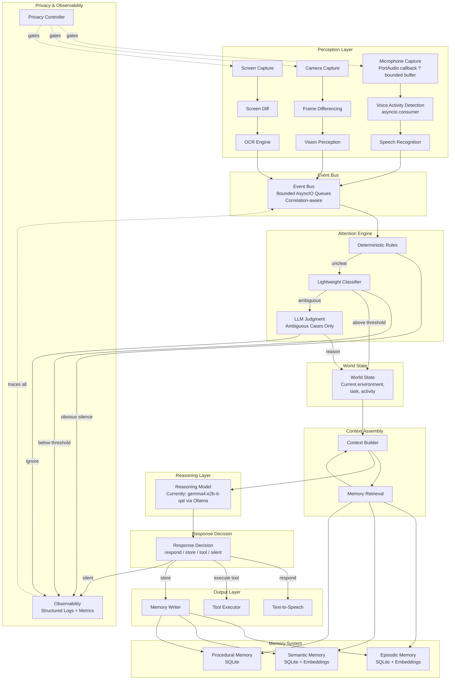
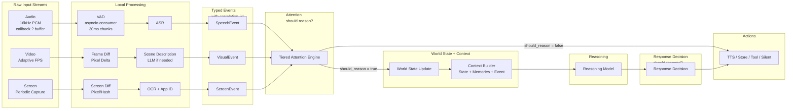
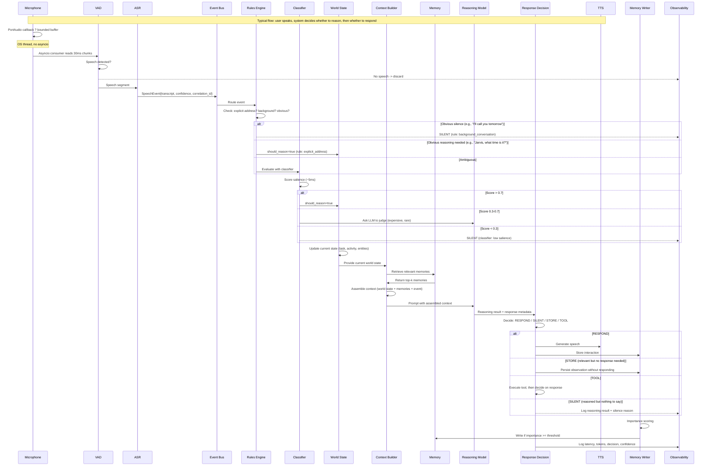

# A ? Executive Architecture Overview

JARVIS is a persistent, multimodal personal AI assistant that continuously perceives its environment ? audio, video, screen ? and selectively responds through voice. It has no wake word. The system's intelligence lies not in answering questions but in knowing *when* to reason, *when* to respond, *when* to remember, and *when* to stay silent.

## Core Design Principle

**Continuous perception, selective reasoning.** The system maintains constant awareness of its environment through cheap, always-running perception pipelines (VAD, frame differencing, screen change detection). Expensive LLM reasoning is invoked only when the attention engine determines something warrants it. The vast majority of perceived input results in silence ? the correct output.

## Architecture in One Paragraph

Audio flows continuously through a VAD ? ASR pipeline. Video flows through adaptive frame sampling ? change detection. Screen capture flows through diff detection ? OCR. All three produce typed **perception events** (which carry correlation IDs for cross-modal grouping) that feed into a shared **attention engine** ? a tiered system of deterministic rules, a lightweight classifier, and (for genuinely ambiguous cases) the LLM itself. The attention engine answers one question: *should the system spend reasoning resources on this?* When yes, events update the **world state** (the system's model of what is happening *right now*), and the **context builder** assembles world state, retrieved persistent memories, and the current event into a compact prompt for the **reasoning model** (currently `gemma4:e2b-it-qat` via Ollama on a GPU host on the local network, with `gemma4:12b` on local Ollama as fallback). The model produces a response, and a separate **response decision** determines the action: respond via TTS, store to memory, execute a tool, or remain silent. Reasoning does not automatically mean responding. The system runs as a single Python process (modular monolith) on the primary development machine (M4 MacBook Air, 16GB).

## Conceptual Flow

```
Perception Events --> Attention ("should reason?") --> World State Update -->
Memory Retrieval + World State + Event --> Context Builder --> Reasoning -->
Response Decision ("should respond?") --> Action (TTS / Store / Tool / Silent)
```

## Key Architectural Decisions

1. **Python monolith** ? single language, single process, asyncio for concurrency. No microservices.
2. **Local-only inference** ? all models run on-device. Cloud fallback deferred to a future reassessment.
3. **Models are replaceable behind interfaces** ? the current implementation uses `gemma4:e2b-it-qat` via Ollama as the reasoning model (local `gemma4:12b` as fallback), Granite Speech 5 for speech recognition, Phonon for TTS, and Silero for VAD. None of these are architectural dependencies; all sit behind abstract interfaces and are swappable via configuration.
4. **Tiered attention** ? rules first, classifier second, LLM last. Most input never touches the LLM. Attention determines whether to *reason*, not whether to *respond*.
5. **Response decision is separate from attention** ? the reasoning model may determine that an event is worth understanding but not worth responding to. "Should reason?" and "should respond?" are distinct questions answered by different components.
6. **World State is distinct from memory** ? world state represents what is happening *now* (transient, in-process). Memory represents what happened *before* (persistent, queryable). Both inform the context builder but serve different purposes.
7. **SQLite + in-process event bus** ? minimal infrastructure for a single-user, single-machine system.
8. **Voice-first output** ? TTS is the primary response channel. Text UI deferred.
9. **MCU JARVIS personality** ? dry wit, formal but warm, British butler energy.
10. **Performance budgets are measurable targets** ? not architectural guarantees. Figures are based on available benchmarks and must be validated empirically on the target hardware.

## Principles Self-Check (Architectural Principle 16)

Tradeoffs explicitly acknowledged:

- **Local-first vs. capability**: The current reasoning model (Gemma 4 E2B, with 12B as local fallback) is capable but not frontier-class. Complex multi-step reasoning will be weaker than a cloud model. Accepted: reassess when quality becomes the bottleneck.
- **Privacy vs. memory richness**: All memory is local, which limits cross-device sync and backup. Accepted: single-machine system for now.
- **Modular monolith vs. isolation**: A single process means a crash in the vision pipeline could take down audio. Mitigation: asyncio task isolation + supervisor pattern for critical loops.
- **M4 Air (base) vs. model size**: 16GB constrains context window and concurrent model loading. The 12B fallback model at Q4 leaves ~8GB for OS + applications + KV cache when it runs on the Mac; the primary model runs on a separate host. Context must be kept compact (~2-4K tokens for typical interactions). This makes the context builder's job critical.

---

# B ? Complete Component Diagram



---

# C ? Data-Flow Diagram



---

# D ? Event-Flow Diagram


