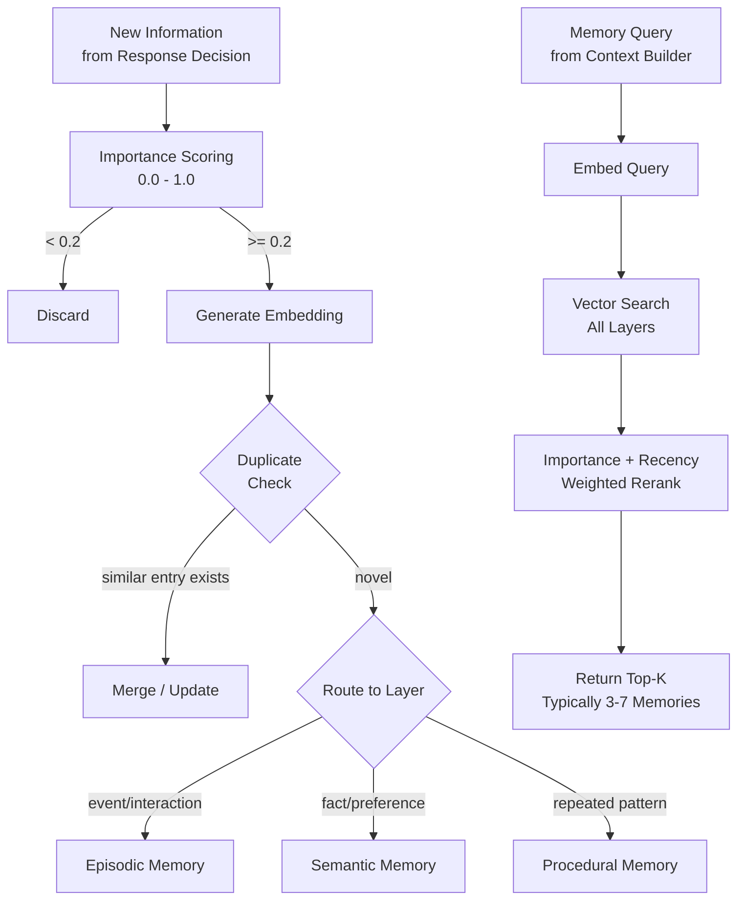
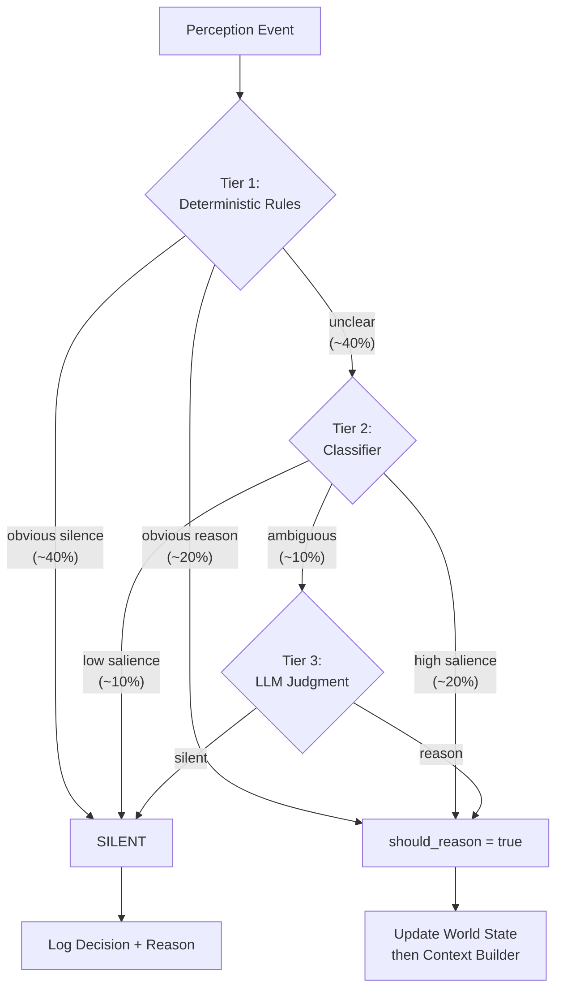

# E ? Memory Architecture

## Design Philosophy

Memory is the mechanism by which JARVIS becomes useful over time. The LLM has no persistent state ? every interaction begins with a blank context window that the memory system populates. Memory is external, queryable, and bounded.

**Memory answers: "What happened previously?"** It is distinct from World State (which answers "What is happening right now?") and from Working Memory (which holds ephemeral conversational context).

## Memory Lifecycle

Memory has two distinct operational paths:

### Retrieval Path (before reasoning)

Memory is queried before the reasoning model is invoked, to provide relevant historical context.

```
Attention fires --> Context Builder --> Memory Retrieval --> Top-k memories --> Assembled Context --> LLM
```

### Consolidation Path (after reasoning)

After reasoning/interaction, the response decision may trigger a memory write. Not every event is persisted ? the Memory Writer applies importance scoring and only stores information above threshold.

```
Response Decision --> Memory Writer --> Importance Scoring --> Store if >= 0.2 / Discard if < 0.2
```

**Key constraint:** Raw continuous perception is never persisted by default. Only information that passes importance scoring enters persistent memory.

```
                    EVENT
                      |
                  ATTENTION
                      |
             +--------+--------+
             |                 |
        MEMORY READ       WORLD STATE
             |                 |
             +--------+--------+
                      |
                CONTEXT BUILDER
                      |
                  REASONING
                      |
               RESPONSE DECISION
                      |
                MEMORY WRITE (conditional)
```

## Three Persistent Memory Layers

### 1. Episodic Memory (What Happened)

**What it holds:** Previous interactions, conversations, projects worked on, notable events, decisions made, outcomes observed.

**Implementation:** SQLite table with columns: `id`, `timestamp`, `summary`, `full_content`, `embedding` (BLOB), `importance` (float 0-1), `access_count`, `last_accessed`, `decay_score`, `source_modality`, `tags`.

**Retrieval:** Vector similarity search on the embedding column (using numpy dot product on SQLite BLOBs ? no pgvector dependency). Top-k retrieval with importance-weighted reranking.

**Lifecycle:** Importance scoring on write. Decay function reduces importance over time (exponential decay with floor). Summarization compresses old episodes. Deduplication merges near-identical entries.

### 2. Semantic Memory (What is Known)

**What it holds:** Facts about the user, preferences, people, projects, environment, relationships between entities.

**Implementation:** SQLite table with columns: `id`, `subject`, `predicate`, `object`, `confidence` (float 0-1), `source_episode_id` (provenance), `created_at`, `updated_at`, `embedding`, `contradiction_of` (nullable FK for explicit contradiction tracking).

**Retrieval:** Combination of keyword match on subject/predicate and vector similarity on embedding. Confidence-weighted.

**Lifecycle:** New facts can contradict existing ones ? when detected, the older fact gets `contradiction_of` set and confidence reduced. Facts with confidence below threshold are candidates for forgetting.

### 3. Procedural Memory (How Things Are Done)

**What it holds:** User workflows, repeated procedures, preferred patterns, tool usage sequences, scheduling habits.

**Implementation:** SQLite table with columns: `id`, `name`, `trigger_pattern`, `steps` (JSON), `frequency`, `last_used`, `success_rate`, `embedding`.

**Retrieval:** Pattern matching on trigger + vector similarity for novel queries.

**Lifecycle:** Discovered through repetition detection. Refined through observation. Decays if unused.

## Memory Operations

```
+-----------------------------------------------------------+
|                    Memory Operations                        |
+-------------+---------------------------------------------+
| STORE       | Score importance -> embed -> write to layer  |
| RETRIEVE    | Query -> vector search -> rerank -> return   |
| UPDATE      | Detect contradiction -> merge or supersede   |
| SUMMARIZE   | Compress old episodes -> reduce storage      |
| DECAY       | Reduce importance over time                  |
| FORGET      | Remove entries below confidence threshold    |
| DEDUPLICATE | Merge semantically identical entries         |
+-------------+---------------------------------------------+
```

## Storage Technology Decision

**Chosen: SQLite (single file, zero infrastructure)**

Rationale for a single-user, single-machine, local-only system:
- No separate process to manage. No connection pooling. No network.
- WAL mode gives concurrent reads with single-writer (asyncio is cooperative, so this is sufficient).
- Embedding search via numpy on BLOBs is fast enough for thousands of memories (sub-10ms for 10K entries at 384-dim).
- Backup is "copy one file." Migration is "alter table."
- If this hits a scale wall (unlikely for personal use), migration path is clear: swap SQLite for PostgreSQL + pgvector. The interface doesn't change.

**Why not Redis for working memory?** Working memory is ~20 items that change every few seconds. The overhead of serializing to Redis, maintaining a connection, and handling Redis process lifecycle adds complexity for zero benefit in a single-process system. A Python dict is the correct data structure here.

**Why not a dedicated vector database?** For personal-scale data (tens of thousands of memories over years of use), in-process vector search over SQLite BLOBs is sub-10ms. A dedicated vector DB (Qdrant, Milvus, Chroma) would add infrastructure for no measurable benefit at this scale.

ponytail: ceiling is ~100K memories before in-process numpy search becomes noticeable (>50ms). Upgrade path: add an in-memory HNSW index (hnswlib, 5 lines) or migrate embeddings to a separate vector store.

## Embedding Model

**Architectural requirement:** An embedding model capable of producing dense vector representations for semantic search.

**Current implementation:** `nomic-embed-text` via Ollama (137M params, 768-dim, runs on CPU in <10ms per embedding). Alternatives: `all-MiniLM-L6-v2` (faster, less capable), `mxbai-embed-large` (better quality, larger). Swappable behind the `EmbeddingModel` interface.

## Memory Flow Diagram



---

# E.1 ? World State

## What World State Is

World State represents the system's understanding of **what is happening right now**. It is transient, in-process, and updated continuously as perception events flow through the system.

**World State answers: "What is happening right now?"**

This is distinct from:
- **Memory** ? "What happened previously?" (persistent, queryable, historical)
- **Working Memory** ? short-lived conversational state (recent turns, used for multi-turn coherence)

## What World State Contains

| Slot | Example | Updated By |
|------|---------|------------|
| Current user | "Sandeep" | Always set |
| Current activity | "software development" | Screen + audio inference |
| Inferred task | "debugging API auth" | Combined modality inference |
| Active application | "VS Code" | Screen events |
| Screen context | "terminal showing 500 error" | Screen events |
| Visual context | "user at desk, alone" | Camera events |
| Recent observations | last N perception summaries | All events |
| Conversation state | "idle" / "active" / "follow-up expected" | Speech + response history |
| Privacy state | "perception active, camera off" | Privacy controller |
| Active entities | ["Arduino board", "sensor"] | Correlated events |

## Implementation

Python dataclass in the main process. No persistence ? lost on restart (this is intentional and correct). Updated by the attention engine when events pass the attention threshold.

```python
@dataclass
class WorldState:
    user: str
    activity: str
    task: str | None
    active_app: str | None
    screen_context: str | None
    visual_context: str | None
    recent_observations: list[str]   # bounded, ~10 items
    conversation_state: str          # idle | active | follow_up
    privacy_mode: bool
    active_entities: list[str]
    last_updated: float
```

## World State vs Working Memory vs Persistent Memory

```
+-------------------+----------------------------+-------------------------------+
| World State       | Working Memory             | Persistent Memory             |
+-------------------+----------------------------+-------------------------------+
| What is now       | Recent conversation        | What happened before          |
| Transient         | Session-scoped             | Persistent (SQLite)           |
| Updated by events | Updated by interactions    | Updated by Memory Writer      |
| Always in context | Always in context          | Retrieved by query            |
| Survives nothing  | Survives within session    | Survives restarts             |
| ~10 fields        | ~10 turns + recent events  | Thousands of entries          |
+-------------------+----------------------------+-------------------------------+
```

---

# F ? Attention Architecture

## The Core Problem

The attention engine is the single most important component for user experience. Get it wrong in either direction and the system is either:
- **Annoying:** Responds to everything, interrupts, feels like a surveillance system with a mouth.
- **Useless:** Never responds, misses obvious requests, feels broken.

The goal: JARVIS should feel like a perceptive, discreet human assistant who's present but not intrusive.

## Attention vs Response Decision

These are explicitly separate concerns:

| Component | Question It Answers | When It Runs |
|-----------|-------------------|--------------|
| **Attention Engine** | "Should JARVIS spend reasoning resources on this event?" | On every perception event |
| **Response Decision** | "Given the reasoning result, should JARVIS actually respond?" | After LLM reasoning completes |

Example ? attention fires but response is silent:

```
User mutters: "I need to fix this API."

Attention:  should_reason = true  (relevant to current task)
Reasoning:  understands context, notes the user's intent
Decision:   respond = false, store = true
            (useful context to remember, but not a question directed at JARVIS)
```

Example ? attention fires and response is generated:

```
User says: "Jarvis, why is this API failing?"

Attention:  should_reason = true  (explicit address)
Reasoning:  formulates answer using context + memory
Decision:   respond = true
            (direct question, answer available)
```

## Attention Architecture: Tiered Filtering

The attention engine is a pipeline of increasingly expensive filters. Each tier handles the cases it's confident about and passes ambiguous cases up.

### Tier 1: Deterministic Rules (< 0.1ms, handles ~60% of events)

Fast, no-ML rules that handle obvious cases:

| Rule | Input Signal | Decision | Confidence |
|------|-------------|----------|------------|
| No speech | VAD = false | SILENT | 1.0 |
| Explicit name | transcript contains "Jarvis" at start | REASON | 0.95 |
| Direct question to system | question + no other humans present | LIKELY_REASON | 0.8 |
| Background conversation | multiple speakers detected | SILENT | 0.9 |
| Music/TV playing | audio event = music/media | SILENT | 0.95 |
| System just responded | < 3s since last response | BOOST (continuation likely) | 0.7 |
| Privacy mode active | privacy flag set | SILENT | 1.0 |

Rules are hard-coded, not learned. They encode social norms and obvious cases.

### Tier 2: Lightweight Classifier (~5ms, handles ~30% of events)

**Architectural requirement:** A fast classifier that scores events on salience and relevance.

**Current implementation:** Initially rule-based scoring (weighted feature combination). Graduates to trained logistic regression after sufficient interaction data accumulates (see Open Questions T3).

**Input features:**
- Speech prosody (question intonation? trailing off? emphatic?)
- Transcript content (question words, imperative verbs, technical terms)
- Context signals (time since last interaction, current task, screen content relevance)
- Visual signals (user looking at camera/screen, gestures)
- Historical patterns (does this user often talk to themselves while coding?)

**Output:**
```json
{
  "salience": 0.72,
  "addressed_to_system": 0.65,
  "is_question": 0.81,
  "urgency": 0.3,
  "category": "debugging_help"
}
```

**Decision thresholds:**
- `salience > 0.7` AND `addressed_to_system > 0.6` -> proceed to reasoning
- `salience < 0.3` OR `addressed_to_system < 0.2` -> SILENT
- Everything else -> Tier 3 (ambiguous)

### Tier 3: LLM Judgment (~1-2s, handles ~10% of events)

For genuinely ambiguous cases, ask the reasoning model directly. This is expensive but rare.

**Prompt template:**
```
You are an attention filter for a personal AI assistant. Given the following context, determine whether this event warrants spending reasoning resources.

Current context:
- User activity: {activity}
- Recent events: {recent_events}
- Current event: {event}

Output JSON:
{"should_reason": bool, "reason": string, "confidence": float}

Guidelines:
- Default to NOT reasoning unless clearly warranted.
- A question spoken aloud while working alone is likely addressed to you.
- Muttering, self-talk, and thinking-out-loud are NOT addressed to you.
- If someone else is in the room, assume speech is addressed to them unless explicitly addressed to you.
```

## Attention Decision Flow



## False Positive / False Negative Handling

The system maintains running counters:
- **False positive rate:** User ignores/dismisses a response, or explicitly says "I wasn't talking to you." Incrementing this tightens thresholds.
- **False negative rate:** User explicitly repeats themselves louder, rephrases, or says "Jarvis?" after getting no response. Incrementing this loosens thresholds.

Threshold adaptation: exponential moving average, adjusted weekly. Stored in semantic memory as user preference.

## Why Not Just Use the LLM for Everything?

At ~25-35 tok/s on the M4 Air (target, unvalidated), each LLM attention judgment takes 1-2 seconds. If the user speaks 10 sentences in a minute, that's 10-20 seconds of GPU time just deciding whether to reason ? leaving no capacity for actually reasoning. The tiered approach ensures the LLM spends its limited compute budget on useful work.

---

# G ? Multimodal Perception Architecture

## Shared Design Pattern

All perception pipelines follow the same pattern:

```
Raw Input -> Cheap Continuous Processing -> Change Detection -> Event Emission -> (Optional) Expensive Analysis
```

The expensive analysis (LLM-based) only happens when the attention engine requests it. Perception itself is cheap.

## Audio Pipeline

```
Microphone (16kHz, mono)
  -> PortAudio/sounddevice callback (OS audio thread)
  -> Thread-safe bounded ring buffer (configurable, default 30s)
  -> Asyncio consumer task
  -> VAD (30ms chunks, <1ms CPU)
  -> Speech segments
  -> ASR (~0.5s per utterance)
  -> SpeechEvent {transcript, confidence, duration, is_question_heuristic, correlation_id}
  -> Event Bus
```

**Key decisions:**
- **Continuous listening:** The ring buffer always records. VAD determines when speech starts/stops. Non-speech audio is discarded (never stored, never sent to ASR).
- **Audio callback isolation:** The sounddevice/PortAudio callback runs on an OS audio thread outside the asyncio event loop. It writes PCM frames to a thread-safe bounded buffer and does nothing else ? no inference, no blocking, no asyncio calls. All processing (VAD, ASR, event publication) runs in asyncio consumer tasks.
- **Streaming ASR:** Process speech segments as they complete (after end-of-speech detected by VAD). No streaming partial transcripts in V1 ? the added complexity isn't worth it until barge-in is needed.
- **Buffer strategy:** Ring buffer size is configurable (default 30 seconds). This allows retroactive transcription if something becomes relevant. Buffer size can be tuned based on speech segmentation requirements, memory usage, and debugging/replay needs.
- **Question detection:** Simple heuristic on transcript (ends with '?', starts with question word). Not ML-based in V1.

**Ring buffer configuration:**
```toml
[audio]
sample_rate = 16000
channels = 1
ring_buffer_seconds = 30  # tunable: longer for debugging, shorter to reduce memory
```

**Latency budget (initial target):** VAD detection (1ms) + end-of-speech wait (300ms silence threshold) + ASR (500ms) = ~800ms from speech end to event. This is an empirical performance target and must be benchmarked during Phase 1 implementation.

## Camera Pipeline (Phase 6 + 7 ? implemented)

```
Camera (OpenCV, built-in or USB)
  -> FrameSampler (bounded queue, latest-frame policy, configurable analysis interval)
  -> ChangeDetector (pixel-level diff, ~1ms)
  -> If significant change:
    -> LocalVisionAnalyzer (Ollama vision model) or MockVisualAnalyzer (testing)
      -> Preprocess (resize, JPEG encode) -> VisionBackend -> Parse JSON
    -> EventDeduplicator (suppress repeated identical events within window)
    -> VisualEvent {event_type, description, confidence, metadata}
    -> Event Bus
  -> If no change:
    -> Discard frame
```

**Key decisions:**
- **Decoupled capture + analysis:** Two independent asyncio tasks. Capture runs at 10 FPS, analysis at 1 FPS. A slow vision model never blocks capture.
- **Latest-frame policy:** FrameSampler keeps only the newest fresh frame. Stale and superseded frames are discarded with separate metrics.
- **Change detection:** Simple pixel delta thresholding between consecutive frames. If difference < threshold, skip analysis.
- **Local vision model:** Frames are sent to Ollama's `/api/chat` with `images` field. The model returns structured JSON (event_type, description, confidence, detections).
- **Privacy:** Camera is explicitly opt-in (disabled by default). Frames are NEVER stored to disk. Raw frame data never appears in logs, SQLite, or events. Only structured text descriptions enter the reasoning pipeline.
- **Graceful degradation:** If Ollama is unavailable, analysis returns None and audio continues. If the camera fails, the perception pipeline is disabled without crashing the application.

## Screen Perception Pipeline

```
Screen capture (macOS CGWindowListCreateImage / Accessibility API)
  -> Periodic capture (every 2-5 seconds, adaptive)
  -> Hash-based change detection (perceptual hash)
  -> If changed:
    -> App identification (window title, bundle ID via Accessibility API)
    -> OCR on changed regions (Apple Vision framework, ~100ms)
    -> ScreenEvent {app_name, window_title, visible_text_excerpt, change_type, correlation_id}
    -> Event Bus
  -> If unchanged:
    -> Discard
```

## Event Correlation

Individual perception events are not always independent. Events occurring close in time across modalities often relate to the same situation.

**Event correlation semantics:**

All events carry a `correlation_id` field from the canonical `Event` envelope (see Event Types below). Events that occur within a short temporal window and relate to the same activity may share a `correlation_id`.

Events that occur within a short temporal window and relate to the same activity may share a `correlation_id`. This allows the context builder to group related observations:

```
              Situation (correlation_id = "abc123")
                          |
             +------------+------------+
             |            |            |
         Audio         Camera        Screen
    "Let's test     Arduino board   Arduino IDE
     this sensor"    detected        opened
```

The exact grouping heuristic (temporal proximity, semantic similarity) is an implementation detail deferred to Phase 5+. The architectural requirement is that the event schema supports correlation.

## Event Types (Canonical Envelope)

The canonical event envelope is the contract used by every subsystem. All events carry these base fields:

```python
@dataclass
class Event:
    """Base event envelope."""
    id: str                     # Uniquely identifies this event (UUID)
    timestamp: float            # When the event occurred (Unix timestamp)
    session_id: str             # Current JARVIS runtime/session identifier
    correlation_id: str | None  # Cross-modal grouping (None if uncorrelated)
    source: Modality            # AUDIO | VISUAL | SCREEN | SYSTEM
    confidence: float           # Perception confidence (0.0 - 1.0)
```

**Field semantics:**
- `id` ? uniquely identifies the event instance
- `timestamp` ? identifies when the event occurred
- `session_id` ? identifies the current JARVIS runtime/session
- `correlation_id` ? allows future cross-modal grouping of related events
- `source` ? identifies the originating modality
- `confidence` ? represents perception confidence

Specialized events extend the base:

```python
@dataclass
class SpeechEvent(Event):
    """Phase 1 ? the only event type implemented initially."""
    transcript: str
    duration_seconds: float
    is_question: bool           # Heuristic
    speaker: str                # "user" or "other" (future: speaker ID)

@dataclass
class VisualEvent(Event):
    """Phase 6+ ? camera perception produced a structured observation."""
    event_type: str             # "SCENE_CHANGE", "PERSON_DETECTED", etc.
    description: str            # 1-2 sentence factual description
    metadata: dict              # analysis_latency_ms, detections, frame_age

@dataclass
class ScreenEvent(Event):
    """Phase 9+ ? screen perception."""
    app_name: str
    window_title: str
    visible_text: str           # Excerpt, not full screen
    change_type: str            # "app_switch" | "content_change" | "new_window"

@dataclass
class SystemEvent(Event):
    """Internal lifecycle events."""
    event_type: str             # "startup" | "shutdown" | "error"
    detail: str
```

`SpeechEvent` (Phase 1) and `VisualEvent` (Phase 6) are implemented. `ScreenEvent` and `SystemEvent` are defined for forward compatibility but are not implemented until their respective phases.

---

# H ? Model Architecture

## Architectural Requirement

Every model in the system sits behind an abstract interface. The architecture does not depend on any specific model vendor, model name, or runtime. Models are swappable via configuration.

```
ReasoningModel (interface)
    |-- Current: Gemma 4 12B Unified (Q4)
    |-- Alternative: Gemma 4 E4B (smaller, faster)
    |-- Future: any model matching the interface

SpeechRecognizer (interface)
    |-- Current: Qwen3-ASR 0.6B
    |-- Alternative: Qwen3-ASR 1.7B, Whisper, Parakeet
    |-- Future: any model matching the interface

VoiceActivityDetector (interface)
    |-- Current: Silero VAD v5
    |-- Alternative: FireRedVAD
    |-- Future: any model matching the interface

TextToSpeech (interface)
    |-- Current: Kokoro-82M
    |-- Alternative: Qwen3-TTS, Holler
    |-- Future: any model matching the interface

EmbeddingModel (interface)
    |-- Current: nomic-embed-text
    |-- Alternative: all-MiniLM-L6-v2, mxbai-embed-large
    |-- Future: any model matching the interface

VisionBackend (interface)
    |-- Current: OllamaVisionBackend (Gemma 4 12B via Ollama)
    |-- Testing: FakeVisionBackend (canned responses)
    |-- Future: any model matching the interface
```

## Current Implementation: Model Hierarchy

| Tier | Role | Current Model | Size | Runtime | Target Latency | Memory |
|------|------|---------------|------|---------|----------------|--------|
| **Perception** | VAD | Silero VAD v5 | 2MB (JIT) | ONNX/CPU | <1ms/chunk | ~50MB |
| **Perception** | ASR | Qwen3-ASR 0.6B | 1.2GB (fp16) | MLX | ~500ms/utterance | ~1.5GB |
| **Perception** | Vision | Gemma 4 12B (same as reasoning) | 7.6GB | Ollama (shared) | ~39s/frame (M4 Air) | shared |
| **Perception** | OCR | Apple Vision | System | CoreML | ~100ms | 0 (system) |
| **Attention** | Classifier | Weighted scoring (initial) | <10MB | CPU | ~5ms | ~50MB |
| **Reasoning** | Primary LLM | Gemma 4 12B Unified (Q4) | 7.6GB | Ollama (llama.cpp Metal) | ~1.5-2s per response | ~9GB |
| **Embeddings** | Memory search | nomic-embed-text | ~500MB | Ollama/CPU | <10ms | ~700MB |
| **Output** | TTS | Kokoro-82M (bf16) | 327MB | MLX | ~200ms short utterance | ~500MB |

**Total memory pressure (peak, all models hot):** ~12GB target. On 16GB system, this leaves ~4GB for OS + apps. In practice, ASR and TTS won't be simultaneously active, and embeddings are loaded on-demand.

## Concurrency Strategy

Models cannot all be resident simultaneously at peak. Strategy:

1. **Always loaded:** VAD (tiny)
2. **Hot standby:** Reasoning model (loaded in Ollama, always ready) ? this is the big one at ~9GB
3. **Load on demand:** ASR (loaded when VAD detects speech), TTS (loaded when response needed), Embeddings (loaded for memory operations)
4. **Mutual exclusion consideration:** On 16GB, running ASR (1.5GB) + Reasoning (9GB) + TTS (0.5GB) simultaneously = ~11GB model memory. Feasible, but context window must be kept short.

ponytail: on 16GB, if memory pressure becomes an issue, the first thing to sacrifice is keeping ASR hot. Load it on VAD trigger (~2s cold start penalty, acceptable for non-streaming ASR).

## Interface Definitions

```python
from abc import ABC, abstractmethod
from dataclasses import dataclass
from typing import AsyncIterator

@dataclass
class ModelResponse:
    text: str
    tokens_used: int
    latency_ms: float
    confidence: float

class ReasoningModel(ABC):
    @abstractmethod
    async def generate(self, prompt: str, max_tokens: int = 512) -> ModelResponse:
        ...

    @abstractmethod
    async def generate_stream(self, prompt: str, max_tokens: int = 512) -> AsyncIterator[str]:
        ...

class SpeechRecognizer(ABC):
    @abstractmethod
    async def transcribe(self, audio: bytes, sample_rate: int = 16000) -> str:
        ...

class VoiceActivityDetector(ABC):
    @abstractmethod
    def process_chunk(self, chunk: bytes) -> bool:
        ...

    @abstractmethod
    def get_speech_segment(self) -> bytes | None:
        ...

class TextToSpeech(ABC):
    @abstractmethod
    async def synthesize(self, text: str, voice: str = "default") -> bytes:
        ...

    @abstractmethod
    async def synthesize_stream(self, text: str, voice: str = "default") -> AsyncIterator[bytes]:
        ...

class EmbeddingModel(ABC):
    @abstractmethod
    async def embed(self, text: str) -> list[float]:
        ...

    @abstractmethod
    async def embed_batch(self, texts: list[str]) -> list[list[float]]:
        ...

class VisionModel(ABC):
    @abstractmethod
    async def describe(self, frame: bytes, prompt: str = "") -> str:
        ...

class AttentionClassifier(ABC):
    @abstractmethod
    def score(self, event: 'Event', context: 'WorldState') -> 'AttentionDecision':
        ...
```

## Why Gemma 4 12B (Current Selection)?

| Criterion | Gemma 4 12B | Llama 3.x 8B | Phi-4 14B | Qwen3 14B |
|-----------|-------------|--------------|-----------|-----------|
| Multimodal (text+image+audio) | Native, encoder-free | Text only | Text + image | Text only |
| Fits 16GB Q4 | Yes (7.6GB) | Yes (4.5GB) | Tight (8.5GB) | Tight (8.5GB) |
| Context window | 256K | 128K | 16K | 128K |
| Local audio understanding | Yes (native) | No | No | No |
| License | Apache 2.0 | Llama license | MIT | Apache 2.0 |
| MLX/Ollama support | Official | Official | Community | Official |

This is an *implementation choice*, not an architectural dependency. The `ReasoningModel` interface is model-agnostic. If a better local model appears, swapping is a configuration change.

---

# I ? Hardware/Runtime Architecture

## Primary Machine: MacBook Air M4 (16GB)

| Component | Spec | Implication |
|-----------|------|-------------|
| CPU | 10-core (4P + 6E) | Adequate for VAD, event processing, Python orchestration |
| GPU | 10-core Metal | Primary inference accelerator. Shared with display. |
| Neural Engine | 16-core | Potentially usable for CoreML models (OCR, small classifiers) |
| Memory | 16GB unified | Shared between CPU, GPU, and OS. Tight for multi-model. |
| Memory bandwidth | 120 GB/s | Bottleneck for large model inference (determines tok/s) |
| Storage | 256GB-512GB SSD | Models + SQLite DB + logs fit easily |
| Microphone | Built-in array | Adequate for solo desk use. External mic optional. |
| Camera | Built-in 12MP | Adequate for desk/room monitoring |

**Target performance for reasoning model (Gemma 4 12B Q4):**
- Decode: ~25-35 tok/s (extrapolated ? M4 Max achieves 101 tok/s via LiteRT-LM with 40 GPU cores; M4 Air has 10 cores and 120 GB/s bandwidth. No published benchmark exists for 12B on base M4 Air specifically. **This estimate must be validated empirically.**)
- Prefill: ~800-1200 tok/s (less GPU-bound)
- Time to first token: ~0.5-1s
- 50-token response: ~1.5-2s generation time (could be 2-3s if decode is closer to 20 tok/s)

Performance figures are engineering targets based on available benchmarks and must be validated on the target M4 Air hardware during implementation. Failure to initially meet a target triggers profiling and evaluation; it does not automatically invalidate the architecture.

**Runtime:** Ollama (wraps llama.cpp with Metal backend). Chosen over raw MLX because:
1. Model management (pull, quantize, swap) is handled
2. OpenAI-compatible API out of the box
3. Supports multiple models simultaneously
4. Community model library (important for swapping/experimenting)
5. Slightly lower peak throughput than raw MLX (~10-15%) but dramatically better developer experience

**Alternative runtime for TTS/ASR:** Direct MLX via `mlx-vlm` (for multimodal queries) and `kokoro-mlx` (for TTS). These use MLX directly because they need streaming and fine-grained control that Ollama's API doesn't expose.

## Secondary Machine: HP Omen (Ryzen 5 4600H, 8GB RAM, GTX 1650 Ti 4GB)

| Component | Spec | Implication |
|-----------|------|-------------|
| CPU | 6-core/12-thread Ryzen 5 | Adequate for orchestration + CPU models |
| GPU | GTX 1650 Ti, 4GB VRAM | Too small for 12B. Can run smaller models. |
| RAM | 8GB DDR4 | Severely limiting. 12B Q4 (7.6GB) won't fit with OS. |
| Storage | SSD | Fine |

**Viable on this machine:**
- Gemma 4 E2B (2.5GB, fits in 4GB VRAM): reduced capability but functional
- ASR on CUDA: fast
- VAD on CPU: same as Mac
- TTS on CPU: slower but functional

**Strategy:** Same codebase, different model configuration. The interface abstraction means swapping models is a config change. Performance will be degraded but functional.

## Runtime Comparison

| Runtime | Use For | Platform | API | Notes |
|---------|---------|----------|-----|-------|
| Ollama | Reasoning model, embeddings | Both | OpenAI-compat | Primary inference server |
| MLX (mlx-vlm) | Multimodal queries | Mac only | Python API | For image/audio understanding |
| kokoro-mlx | TTS | Mac only | Python API | Low-latency voice synthesis |
| mlx-qwen3-asr | ASR | Mac only | Python API | Speech recognition |
| Silero VAD | VAD | Both | Python (ONNX) | Voice activity detection |
| LiteRT-LM | Potential Ollama replacement | Both | OpenAI-compat | Google's runtime; potentially higher throughput but newer |
