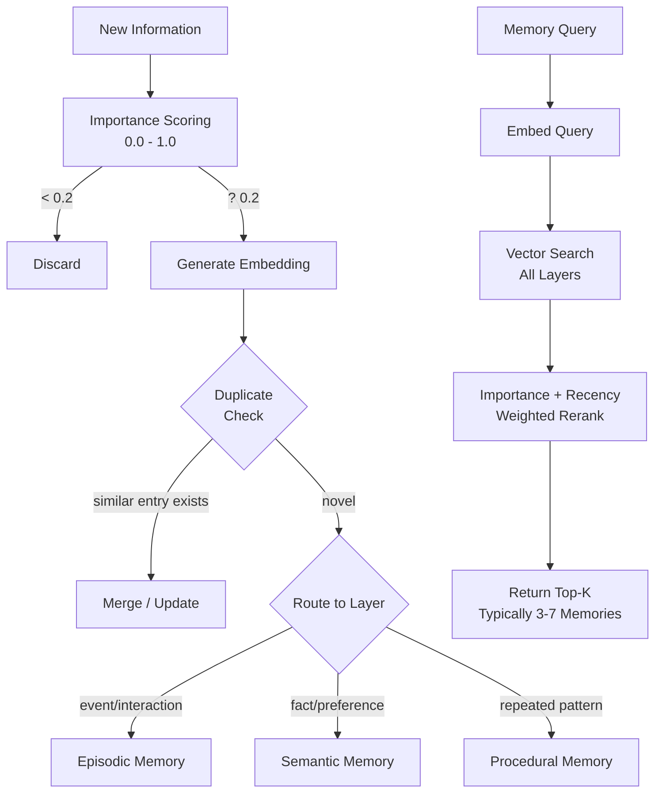
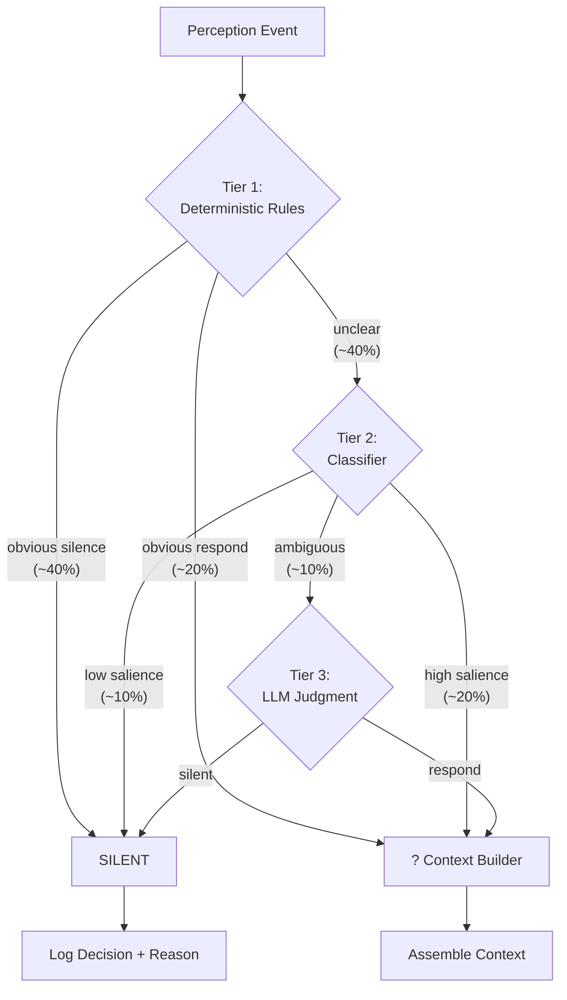

# ?E ? Memory Architecture

## Design Philosophy

Memory is the mechanism by which JARVIS becomes useful over time. The LLM has no persistent state ? every interaction begins with a blank context window that the memory system populates. Memory is external, queryable, and bounded.

## Four Memory Layers

### 1. Working Memory (In-Process State)

**What it holds:** Current conversation turns, current task context, current environment state, events from the last ~5 minutes, active tool executions.

**Implementation:** Python dataclass instances in the main process. No persistence ? lost on restart (this is intentional; working memory is ephemeral).

**Capacity:** ~20 recent events, ~10 conversation turns, current environment snapshot.

**Access pattern:** Direct attribute access, no query needed. Always included in context.

### 2. Episodic Memory (What Happened)

**What it holds:** Previous interactions, conversations, projects worked on, notable events, decisions made, outcomes observed.

**Implementation:** SQLite table with columns: `id`, `timestamp`, `summary`, `full_content`, `embedding` (BLOB), `importance` (float 0-1), `access_count`, `last_accessed`, `decay_score`, `source_modality`, `tags`.

**Retrieval:** Vector similarity search on the embedding column (using numpy dot product on SQLite BLOBs ? no pgvector dependency). Top-k retrieval with importance-weighted reranking.

**Lifecycle:** Importance scoring on write. Decay function reduces importance over time (exponential decay with floor). Summarization compresses old episodes. Deduplication merges near-identical entries.

### 3. Semantic Memory (What is Known)

**What it holds:** Facts about the user, preferences, people, projects, environment, relationships between entities.

**Implementation:** SQLite table with columns: `id`, `subject`, `predicate`, `object`, `confidence` (float 0-1), `source_episode_id` (provenance), `created_at`, `updated_at`, `embedding`, `contradiction_of` (nullable FK for explicit contradiction tracking).

**Retrieval:** Combination of keyword match on subject/predicate and vector similarity on embedding. Confidence-weighted.

**Lifecycle:** New facts can contradict existing ones ? when detected, the older fact gets `contradiction_of` set and confidence reduced. Facts with confidence below threshold are candidates for forgetting.

### 4. Procedural Memory (How Things Are Done)

**What it holds:** User workflows, repeated procedures, preferred patterns, tool usage sequences, scheduling habits.

**Implementation:** SQLite table with columns: `id`, `name`, `trigger_pattern`, `steps` (JSON), `frequency`, `last_used`, `success_rate`, `embedding`.

**Retrieval:** Pattern matching on trigger + vector similarity for novel queries.

**Lifecycle:** Discovered through repetition detection. Refined through observation. Decays if unused.

## Memory Operations

```
???????????????????????????????????????????????????????????
?                    Memory Operations                      ?
???????????????????????????????????????????????????????????
? STORE       ? Score importance ? embed ? write to layer  ?
? RETRIEVE    ? Query ? vector search ? rerank ? return    ?
? UPDATE      ? Detect contradiction ? merge or supersede  ?
? SUMMARIZE   ? Compress old episodes ? reduce storage     ?
? DECAY       ? Reduce importance over time                ?
? FORGET      ? Remove entries below confidence threshold  ?
? DEDUPLICATE ? Merge semantically identical entries       ?
???????????????????????????????????????????????????????????
```

## Storage Technology Decision

**Chosen: SQLite (single file, zero infrastructure)**

Rationale for a single-user, single-machine, local-only system:
- No separate process to manage. No connection pooling. No network.
- WAL mode gives concurrent reads with single-writer (asyncio is cooperative, so this is sufficient).
- Embedding search via numpy on BLOBs is fast enough for thousands of memories (sub-10ms for 10K entries at 384-dim).
- Backup is "copy one file." Migration is "alter table."
- If this hits a scale wall (unlikely for personal use), migration path is clear: swap SQLite for PostgreSQL + pgvector. The interface doesn't change.

**Why not Redis for working memory?** Working memory is ~20 items that change every few seconds. The overhead of serializing to Redis, maintaining a connection, and handling Redis process lifecycle adds complexity for zero benefit in a single-process system. A Python dict is the correct data structure here.

**Why not a dedicated vector database?** For personal-scale data (tens of thousands of memories over years of use), in-process vector search over SQLite BLOBs is sub-10ms. A dedicated vector DB (Qdrant, Milvus, Chroma) would add infrastructure for no measurable benefit at this scale.

ponytail: ceiling is ~100K memories before in-process numpy search becomes noticeable (>50ms). Upgrade path: add an in-memory HNSW index (hnswlib, 5 lines) or migrate embeddings to a separate vector store.

## Embedding Model

**Chosen: `nomic-embed-text` via Ollama** (137M params, 768-dim, runs on CPU in <10ms per embedding)

Alternatives considered: `all-MiniLM-L6-v2` (faster but less capable), `mxbai-embed-large` (better quality, larger). Nomic is the sweet spot ? high quality, small enough to run alongside the 12B model without memory pressure, and available through Ollama's unified interface.

## Memory Flow Diagram



---

# ?F ? Attention Architecture

## The Core Problem

The attention engine is the single most important component for user experience. Get it wrong in either direction and the system is either:
- **Annoying:** Responds to everything, interrupts, feels like a surveillance system with a mouth.
- **Useless:** Never responds, misses obvious requests, feels broken.

The goal: JARVIS should feel like a perceptive, discreet human assistant who's present but not intrusive. It speaks when spoken to, notices when you're struggling, and stays out of the way otherwise.

## Architecture: Tiered Filtering

The attention engine is a pipeline of increasingly expensive filters. Each tier handles the cases it's confident about and passes ambiguous cases up.

### Tier 1: Deterministic Rules (< 0.1ms, handles ~60% of events)

Fast, no-ML rules that handle obvious cases:

| Rule | Input Signal | Decision | Confidence |
|------|-------------|----------|------------|
| No speech | VAD = false | SILENT | 1.0 |
| Explicit name | transcript contains "Jarvis" | RESPOND | 0.95 |
| Direct question to system | question + no other humans present | LIKELY_RESPOND | 0.8 |
| Background conversation | multiple speakers detected | SILENT | 0.9 |
| Music/TV playing | audio event = music/media | SILENT | 0.95 |
| System just responded | < 3s since last response | BOOST (continuation likely) | 0.7 |
| Privacy mode active | privacy flag set | SILENT | 1.0 |

Rules are hard-coded, not learned. They encode social norms and obvious cases. They're fast because they're just boolean checks on event metadata.

### Tier 2: Lightweight Classifier (~5ms, handles ~30% of events)

A small model (or logistic regression / small neural net) that scores the remaining events on multiple dimensions:

**Input features:**
- Speech prosody (question intonation? trailing off? emphatic?)
- Transcript content (question words, imperative verbs, technical terms)
- Context signals (time since last interaction, current task, screen content relevance)
- Visual signals (user looking at camera/screen, gestures)
- Historical patterns (does this user often talk to themselves while coding?)

**Output:**
```json
{
  "salience": 0.72,
  "addressed_to_system": 0.65,
  "is_question": 0.81,
  "urgency": 0.3,
  "category": "debugging_help"
}
```

**Decision thresholds:**
- `salience > 0.7` AND `addressed_to_system > 0.6` ? proceed to reasoning
- `salience < 0.3` OR `addressed_to_system < 0.2` ? SILENT
- Everything else ? Tier 3 (ambiguous)

**Training strategy:** Initially rule-based scoring (weighted feature combination). As interaction data accumulates, train a proper classifier on user feedback (implicit: did the user accept/reject/ignore the response?).

### Tier 3: LLM Judgment (~1-2s, handles ~10% of events)

For genuinely ambiguous cases, ask the reasoning model directly. This is expensive but rare.

**Prompt template:**
```
You are an attention filter for a personal AI assistant. Given the following context, determine whether this event requires a response.

Current context:
- User activity: {activity}
- Recent events: {recent_events}
- Current event: {event}

Output JSON:
{"should_respond": bool, "reason": string, "confidence": float}

Guidelines:
- Silence is the default. Only respond if clearly addressed or if proactive help would be genuinely useful.
- A question spoken aloud while working alone is likely addressed to you.
- Muttering, self-talk, and thinking-out-loud are NOT addressed to you.
- If someone else is in the room, assume speech is addressed to them unless explicitly addressed to you.
```

## Decision Flow



## False Positive / False Negative Handling

The system maintains running counters:
- **False positive rate:** User ignores/dismisses a response, or explicitly says "I wasn't talking to you." Incrementing this tightens thresholds.
- **False negative rate:** User explicitly repeats themselves louder, rephrases, or says "Jarvis?" after getting no response. Incrementing this loosens thresholds.

Threshold adaptation: exponential moving average, adjusted weekly. Stored in semantic memory as user preference.

## Why Not Just Use the LLM for Everything?

At ~30 tok/s on the M4 Air, each LLM attention judgment takes 1-2 seconds. If the user speaks 10 sentences in a minute, that's 10-20 seconds of GPU time just deciding whether to respond ? leaving no capacity for actually responding. The tiered approach ensures the LLM spends its limited compute budget on actual reasoning, not gatekeeping.

---

# ?G ? Multimodal Perception Architecture

## Shared Design Pattern

All perception pipelines follow the same pattern:

```
Raw Input ? Cheap Continuous Processing ? Change Detection ? Event Emission ? (Optional) Expensive Analysis
```

The expensive analysis (LLM-based) only happens when the attention engine requests it. Perception itself is cheap.

## Audio Pipeline

```
Microphone (16kHz, mono)
  ? Ring buffer (30s rolling)
  ? VAD (Silero, 30ms chunks, <1ms CPU)
  ? Speech segments
  ? ASR (Qwen3-ASR 0.6B, ~0.5s per utterance on MLX)
  ? SpeechEvent {transcript, confidence, duration, is_question_heuristic}
  ? Event Bus
```

**Key decisions:**
- **Continuous listening:** The ring buffer always records. VAD determines when speech starts/stops. Non-speech audio is discarded (never stored, never sent to ASR).
- **Streaming ASR:** Process speech segments as they complete (after end-of-speech detected by VAD). No streaming partial transcripts in V1 ? the added complexity isn't worth it until barge-in is needed.
- **Buffer strategy:** 30-second rolling buffer means we can retroactively transcribe if something becomes relevant. E.g., the user mutters something, then 5 seconds later says "what did I just say?"
- **Question detection:** Simple heuristic on transcript (ends with '?', starts with question word, rising intonation if supported by ASR). Not ML-based in V1.

**Latency budget:** VAD detection (1ms) + end-of-speech wait (300ms silence threshold) + ASR (500ms) = ~800ms from speech end to event.

## Camera Pipeline

```
Camera (built-in MacBook)
  ? Adaptive frame sampling (1-5 FPS based on change rate)
  ? Frame differencing (pixel-level, ~1ms)
  ? If significant change:
    ? Lightweight description (YOLO/object detection OR Gemma 4 vision, depending on change magnitude)
    ? VisualEvent {description, objects_detected, scene_change_magnitude, timestamp}
    ? Event Bus
  ? If no change:
    ? Discard frame
```

**Key decisions:**
- **Adaptive FPS:** When the scene is static (user sitting at desk), sample at 1 FPS. When motion detected, ramp to 5 FPS. Never higher ? this isn't a security camera.
- **Change detection:** Simple pixel delta thresholding between consecutive frames. If < 5% of pixels changed by > threshold, discard.
- **Two-stage analysis:** Small changes (5-15% pixel delta) get lightweight processing (object detection if available, or skip). Large changes (>15% delta) get LLM vision analysis.
- **Privacy:** Camera is explicitly opt-in. Clear visual indicator when active. Frames are NEVER stored to disk by default. Only the extracted event (text description) persists.

**Latency budget:** Frame capture (10ms) + differencing (1ms) + description if needed (1-3s via LLM) = 10ms for discarded frames, 1-3s for analyzed frames.

## Screen Perception Pipeline

```
Screen capture (macOS CGWindowListCreateImage)
  ? Periodic capture (every 2-5 seconds, adaptive)
  ? Hash-based change detection (perceptual hash)
  ? If changed:
    ? App identification (window title, bundle ID via Accessibility API)
    ? OCR on changed regions (Apple Vision framework, ~100ms)
    ? ScreenEvent {app_name, window_title, visible_text_excerpt, change_type}
    ? Event Bus
  ? If unchanged:
    ? Discard
```

**Key decisions:**
- **Capture frequency:** Every 2s when actively working (typing/clicking detected), every 5s when idle. Never captures during privacy mode.
- **Change detection:** Perceptual hash (pHash) comparison, not pixel-level. Tolerant of minor rendering differences.
- **App identification:** Use macOS Accessibility APIs to get the frontmost app name and window title without OCR. OCR is only for content understanding.
- **OCR scope:** Only OCR changed regions, not the full screen. Use Apple's built-in Vision framework (fast, free, private).

**Latency budget:** Capture (5ms) + hash (1ms) + OCR if needed (100ms) + app ID (5ms) = 5ms for unchanged, ~110ms for changed screens.

## Event Types (Shared Schema)

All perception events share a base shape:

```python
@dataclass
class PerceptionEvent:
    id: str                     # UUID
    timestamp: float            # Unix timestamp
    source: Modality            # AUDIO | VISUAL | SCREEN
    importance_hint: float      # 0.0 - 1.0, from perception layer
    raw_available: bool         # Whether raw data can be retrieved from buffer

@dataclass
class SpeechEvent(PerceptionEvent):
    transcript: str
    confidence: float
    duration_seconds: float
    is_question: bool           # Heuristic
    speaker: str                # "user" or "other" (future: speaker ID)

@dataclass
class VisualEvent(PerceptionEvent):
    description: str
    objects: list[str]
    scene_change_magnitude: float
    frame_available: bool       # Can we retrieve the frame from buffer?

@dataclass
class ScreenEvent(PerceptionEvent):
    app_name: str
    window_title: str
    visible_text: str           # Excerpt, not full screen
    change_type: str            # "app_switch" | "content_change" | "new_window"
```

---

# ?H ? Model Architecture

## Model Hierarchy

| Tier | Role | Model | Size | Runtime | Latency | Memory |
|------|------|-------|------|---------|---------|--------|
| **Perception** | VAD | Silero VAD v5 | 2MB (JIT) | ONNX/CPU | <1ms/chunk | ~50MB |
| **Perception** | ASR | Qwen3-ASR 0.6B | 1.2GB (fp16) | MLX | ~500ms/utterance | ~1.5GB |
| **Perception** | OCR | Apple Vision | System | CoreML | ~100ms | 0 (system) |
| **Attention** | Classifier | TBD (logistic ? small NN) | <10MB | CPU/sklearn | ~5ms | ~50MB |
| **Reasoning** | Primary LLM | Gemma 4 12B Unified (Q4) | 7.6GB | Ollama (llama.cpp Metal) | ~1.5-2s per response | ~9GB |
| **Embeddings** | Memory search | nomic-embed-text | ~500MB | Ollama/CPU | <10ms | ~700MB |
| **Output** | TTS | Kokoro-82M (bf16) | 327MB | MLX | ~200ms for short utterance | ~500MB |

**Total memory pressure (peak, all models hot):** ~12GB. On 16GB system, this leaves ~4GB for OS + apps. Acceptable but tight. In practice, ASR and TTS won't be simultaneously active, and embeddings are loaded on-demand.

## Concurrency Strategy

Models cannot all be resident simultaneously at peak. Strategy:

1. **Always loaded:** VAD (tiny), Working Memory (in-process state)
2. **Hot standby:** Gemma 4 12B (loaded in Ollama, always ready) ? this is the big one at ~9GB
3. **Load on demand:** ASR (loaded when VAD detects speech), TTS (loaded when response needed), Embeddings (loaded for memory operations)
4. **Mutual exclusion consideration:** On 16GB, running ASR (1.5GB) + Gemma 4 (9GB) + TTS (0.5GB) simultaneously = ~11GB model memory. Feasible, but context window must be kept short.

ponytail: on 16GB, if memory pressure becomes an issue, the first thing to sacrifice is keeping ASR hot. Load it on VAD trigger (~2s cold start penalty, acceptable for non-streaming ASR).

## Interface Definitions

```python
from abc import ABC, abstractmethod
from dataclasses import dataclass
from typing import AsyncIterator

@dataclass
class ModelResponse:
    text: str
    tokens_used: int
    latency_ms: float
    confidence: float

class ReasoningModel(ABC):
    @abstractmethod
    async def generate(self, prompt: str, max_tokens: int = 512) -> ModelResponse:
        ...

    @abstractmethod
    async def generate_stream(self, prompt: str, max_tokens: int = 512) -> AsyncIterator[str]:
        ...

class SpeechRecognizer(ABC):
    @abstractmethod
    async def transcribe(self, audio: bytes, sample_rate: int = 16000) -> str:
        ...

class VoiceActivityDetector(ABC):
    @abstractmethod
    def process_chunk(self, chunk: bytes) -> bool:
        """Returns True if speech detected in this chunk."""
        ...

    @abstractmethod
    def get_speech_segment(self) -> bytes | None:
        """Returns complete speech segment if one has ended, else None."""
        ...

class TextToSpeech(ABC):
    @abstractmethod
    async def synthesize(self, text: str, voice: str = "bf_emma") -> bytes:
        """Returns audio bytes (WAV, 24kHz)."""
        ...

    @abstractmethod
    async def synthesize_stream(self, text: str, voice: str = "bf_emma") -> AsyncIterator[bytes]:
        """Streams audio chunks for low-latency playback."""
        ...

class EmbeddingModel(ABC):
    @abstractmethod
    async def embed(self, text: str) -> list[float]:
        ...

    @abstractmethod
    async def embed_batch(self, texts: list[str]) -> list[list[float]]:
        ...

class VisionModel(ABC):
    @abstractmethod
    async def describe(self, frame: bytes, prompt: str = "") -> str:
        """Describe a visual frame. Optional prompt for directed questions."""
        ...

class AttentionClassifier(ABC):
    @abstractmethod
    def score(self, event: 'PerceptionEvent', context: 'WorkingMemory') -> 'AttentionScore':
        ...
```

## Why Gemma 4 12B?

| Criterion | Gemma 4 12B | Llama 3.x 8B | Phi-4 14B | Qwen3 14B |
|-----------|-------------|--------------|-----------|-----------|
| Multimodal (text+image+audio) | Native, encoder-free | Text only | Text + image | Text only |
| Fits 16GB Q4 | Yes (7.6GB) | Yes (4.5GB) | Tight (8.5GB) | Tight (8.5GB) |
| Context window | 256K | 128K | 16K | 128K |
| Local audio understanding | Yes (native) | No | No | No |
| License | Apache 2.0 | Llama license | MIT | Apache 2.0 |
| MLX/Ollama support | Official | Official | Community | Official |
| Thinking mode | Configurable | No | No | Yes |

Gemma 4 12B is the only model in its size class that natively handles text, image, AND audio in a single encoder-free architecture. For a multimodal assistant, this eliminates the need for a separate vision model for complex queries ? the reasoning model can directly understand images and audio when needed.

---

# ?I ? Hardware/Runtime Architecture

## Primary Machine: MacBook Air M4 (16GB)

| Component | Spec | Implication |
|-----------|------|-------------|
| CPU | 10-core (4P + 6E) | Adequate for VAD, event processing, Python orchestration |
| GPU | 10-core Metal | Primary inference accelerator. Shared with display. |
| Neural Engine | 16-core | Potentially usable for CoreML models (OCR, small classifiers) |
| Memory | 16GB unified | Shared between CPU, GPU, and OS. Tight for multi-model. |
| Memory bandwidth | 120 GB/s | Bottleneck for large model inference (determines tok/s) |
| Storage | 256GB-512GB SSD | Models + SQLite DB + logs fit easily |
| Microphone | Built-in array | Adequate for solo desk use. External mic optional. |
| Camera | Built-in 12MP | Adequate for desk/room monitoring |

**Expected Gemma 4 12B performance on M4 Air (Q4):**
- Decode: ~25-35 tok/s (extrapolated ? M4 Max with 40 GPU cores achieves 101 tok/s via LiteRT-LM; M4 Air has 10 cores and 120 GB/s bandwidth vs Max's 273 GB/s. No published benchmark exists for 12B on base M4 Air specifically. This estimate could be optimistic; actual numbers must be measured in Phase 1.)
- Prefill: ~800-1200 tok/s (less GPU-bound)
- Time to first token: ~0.5-1s
- 50-token response: ~1.5-2s generation time (could be 2-3s if decode is closer to 20 tok/s)

**Runtime:** Ollama (wraps llama.cpp with Metal backend). Chosen over raw MLX because:
1. Model management (pull, quantize, swap) is handled
2. OpenAI-compatible API out of the box
3. Supports multiple models simultaneously
4. Community model library (important for swapping/experimenting)
5. Slightly lower peak throughput than raw MLX (~10-15%) but dramatically better developer experience

**Alternative runtime for TTS/ASR:** Direct MLX via `mlx-vlm` (for Gemma 4 multimodal) and `kokoro-mlx` (for TTS). These use MLX directly because they need streaming and fine-grained control that Ollama's API doesn't expose.

## Secondary Machine: HP Omen (Ryzen 5 4600H, 8GB RAM, GTX 1650 Ti 4GB)

| Component | Spec | Implication |
|-----------|------|-------------|
| CPU | 6-core/12-thread Ryzen 5 | Adequate for orchestration + CPU models |
| GPU | GTX 1650 Ti, 4GB VRAM | Too small for Gemma 4 12B. Can run smaller models. |
| RAM | 8GB DDR4 | Severely limiting. Gemma 4 Q4 (7.6GB) won't fit with OS. |
| Storage | SSD | Fine |

**Viable on this machine:**
- Gemma 4 E2B (2.5GB, fits in 4GB VRAM): reduced capability but functional
- Qwen3-ASR 0.6B on CUDA: fast ASR
- Silero VAD on CPU: same as Mac
- TTS on CPU: slower but functional

**Strategy:** Same codebase, different model configuration. The interface abstraction means swapping `gemma-4-12b` for `gemma-4-e2b` is a config change. Performance will be degraded but functional.

## Runtime Comparison

| Runtime | Use For | Platform | API | Notes |
|---------|---------|----------|-----|-------|
| Ollama | Gemma 4 12B, embeddings | Both | OpenAI-compat | Primary inference server |
| MLX (mlx-vlm) | Gemma 4 multimodal queries | Mac only | Python API | For image/audio understanding |
| kokoro-mlx | TTS | Mac only | Python API | Low-latency voice synthesis |
| mlx-qwen3-asr | ASR | Mac only | Python API | Speech recognition |
| Silero VAD | VAD | Both | Python (ONNX) | Voice activity detection |
| LiteRT-LM | Potential Ollama replacement | Both | OpenAI-compat | Google's runtime; higher throughput on Mac but newer, less battle-tested |

**LiteRT-LM consideration:** Google's official runtime for Gemma 4 shows impressive numbers (101 tok/s decode for 12B on M4 Max). However: it's newer, less battle-tested, and the E4B/E2B benchmarks don't directly translate to 12B on M4 Air (non-Max). Listed as an upgrade path once it matures further and community benchmarks on base M4 confirm the numbers. For now, Ollama provides stability and ecosystem compatibility.
